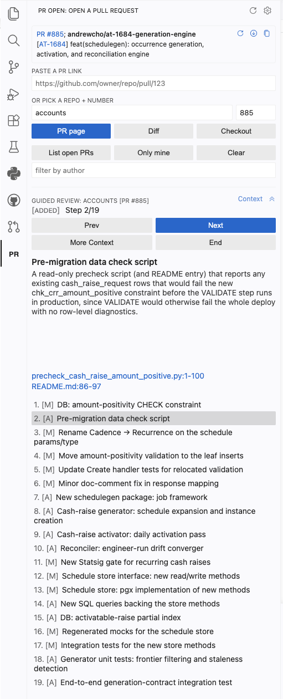

# PR Open

AI guided PR reviews natively within VSCode.

<p align="center">
  
</p>

## Features

- **Open a PR** by URL or repo + number, into the GitHub PR extension's page or diff view.
- **List open PRs** for a repo, with a **Only mine** filter and author search.
- **Checkout + status:** check out a PR's branch in place, and see it at a glance with links to the
  PR and its Linear ticket, plus a one-click **Pull** when behind the remote head. Reviews always
  land in a tree pr-open controls: your clone when it can take the branch, otherwise a worktree on a
  dedicated `pr-open/review/*` branch under `~/.pr-open/worktrees` (kept to the 3 most recent). So a
  PR whose branch an agent already has checked out, or one that arrives while your clone has work in
  it, opens without disturbing either. The review cannot drift when that agent commits or switches
  branches.
  Edit freely in a review worktree: updating one you have edits in asks first, and falling off the end
  of the 3 most recent commits them to the clone before removing the tree, so the work is recoverable
  from the oid the warning hands you (for as long as `gc.pruneExpire` keeps it, two weeks by default).
- **Guided review:** an AI walkthrough that runs the `claude` CLI over the diff and groups it into
  ordered steps that stream in. Each step opens the relevant diff and explains what changed and
  why. Generated, vendored and binary artifacts become a compact collateral manifest; source diffs
  are split into bounded batches when needed. Cached per HEAD; **Regenerate with more context**
  reruns with richer explanations.
- **Ask Claude:** the panel's collapsible **Ask Claude** box is one continuous conversation about the
  checked-out PR. The first question carries the whole diff, every later one resumes that session, so
  the diff is paid for once however long you go. Selecting lines in a diff narrows the next question
  to them without starting over, and clearing the selection widens back out to the whole PR.
- **Ask about a line:** the gutter `+` on a PR diff stays what it has always been, a GitHub review
  comment. Its box just carries an **Ask Claude** button next to **Comment**, so the same lines can
  go to your reviewer or to Claude. You can also right-click a line number or press `cmd+alt+/`. A
  line question opens a comment thread of its own, and replies keep that thread's conversation going.
  Either way Claude gets the PR diff plus read-only access to the clone, so it can follow a caller or
  read a test to answer, and every question lands in the panel's transcript with a link back to the
  lines. All of it is local to your window: only the `+` reaches GitHub.
- **Address PR comments:** the button under **Ask** takes every unresolved review thread on the
  checked-out PR at once. Claude fixes what it can in the working tree, pr-open commits that as
  `Address review comments` and pushes it to the PR's head branch, and only then posts a reply on each
  thread and marks it resolved. That order is the point: a reply saying "Fixed" cites a commit the
  reviewer can already see. A thread Claude declines keeps its reply and stays open for you. This is
  the one path that writes to GitHub, and it refuses to start rather than post something it cannot back
  up: the tree must be clean, the checkout must be at the PR's head commit, and the PR must not come
  from a fork. Progress and every reply as posted show in the panel.

## Install

Requires the [GitHub Pull Requests](https://marketplace.visualstudio.com/items?itemName=GitHub.vscode-pull-request-github)
extension (v0.158.0+). Guided review needs the [`claude` CLI](https://claude.com/claude-code) on
your PATH.

```bash
git clone git@github.com:andrew-cho-moment/pr-open.git
cd pr-open
./install.sh              # installs the latest published release (needs the `gh` CLI)
```

The extension checks for a newer release once a day on startup and prompts only when one exists,
installing it in place and offering a reload (turn this off with `prOpen.checkForUpdatesOnStartup`).
Rerunning `./install.sh` still works. For a dev host, press `F5` in `vscode-extension/`.

Then set your search roots in Settings:

```jsonc
"prOpen.searchRoots": ["~/dev"],                 // required: dirs scanned for clones; owner/repo resolves to <root>/<repo>
"prOpen.cloneRoot": "~/dev",                      // where missing repos are cloned (defaults to first search root)
"prOpen.review.model": "claude-opus-4-8",         // model passed to `claude --model` (defaults to sonnet)
"prOpen.review.includeBusinessContext": true,     // summarize the concrete problem + resolution (defaults to true)
"prOpen.ask.model": "claude-opus-4-8",            // model used to answer questions about a diff line (defaults to sonnet)
"prOpen.address.model": "claude-opus-4-8",         // model used to fix and answer review comments (defaults to sonnet)
"prOpen.adversarialReview.model": "claude-opus-5", // model used to review the PR adversarially (defaults to fable)
"prOpen.adversarialReview.standardsSection": "Design", // section of ~/.claude/CLAUDE.md a design finding is judged against
"prOpen.adversarialReview.instructionsSection": "Communication", // section of ~/.claude/CLAUDE.md a finding is worded from
"prOpen.checkForUpdatesOnStartup": true           // check GitHub for a newer release once a day on startup (defaults to true)
```
The system prompts (`vscode-extension/prompt-review.md`, `prompt-context.md`, `prompt-ask.md`,
`prompt-address.md`, and `prompt-adversarial.md`) are plain Markdown and meant to be edited; reload
the window to pick up changes.

The adversarial review is the one run that reads your own `~/.claude/CLAUDE.md`. A claude subprocess
runs with `--setting-sources ''`, which loads no CLAUDE.md, so pr-open reads the file itself and
slices it into the blocks it appends, each under a heading naming what it governs and each fenced,
so a heading in your own file cannot swallow that boundary. `standardsSection` supplies the design
standard a finding is judged against: code that breaks one of its rules is reportable.
`instructionsSection` supplies the voice a finding is worded in. The two blocks never share a line,
whichever sections your file turns out to carry: a missing voice section takes whatever the
standard did not claim, and a file naming neither, or nesting one inside the other, is appended
once under a heading that gives that text both jobs. Neither block changes the output format or the rule that every comment anchors on a
line of the diff.

`includeBusinessContext` scopes the guided review only. A question always gets the PR title and
description, since "why does this exist" is unanswerable without them.

## Usage

Click the PR Open icon in the activity bar, then paste a PR URL or pick a repo + number. Each
entry has **PR page**, **Diff**, and **Checkout** actions. Start a guided review from the panel or
the command palette (`PR Open: Start Guided Review`); the PR's branch must be checked out first.

**Adversarial review** reads the checked-out PR for correctness, design and style, and files each
finding as an inline comment on a *pending* GitHub review: a draft only you can see, which reaches
the PR author when you press **Submit review** on github.com. Every finding has to name what breaks
or what a reader pays, so a bare preference is not one. `vscode-extension/prompt-adversarial.md`
holds the rubric, under "What counts as a finding", and is the file to edit when a run reports too
much or too little.

pr-open never submits, approves, or requests changes. A finding that names a real file but a line
outside the diff is listed in the review's summary comment; one naming a file the diff never
touched is dropped to the `PR Open` log, and a run in which nothing anchors fails rather than
filing an empty review.

To ask about the PR, type in the panel's **Ask Claude** box; questions there continue one
conversation. To pin a question to specific lines, select them in a diff and press `cmd+alt+/` (or
right-click, or right-click the line number), or click **Ask Claude** in a review comment box. Both
work with the PR's branch checked out whether or not a guided review is running; without one, the
merge base has to already be local (starting a review fetches it).

## Tips

- The repo and author fields complete like a shell: type a few characters, then Tab (or Enter) to accept the highlighted suggestion, arrows to move through them, Escape to dismiss. Click the field to see every option
- I like putting in-line git comments directly, then having an LLM reply to my comments (either fixing issue or replying)
- I read the PR body first (especially while the guided review is generating - sometimes it can be slow!)
